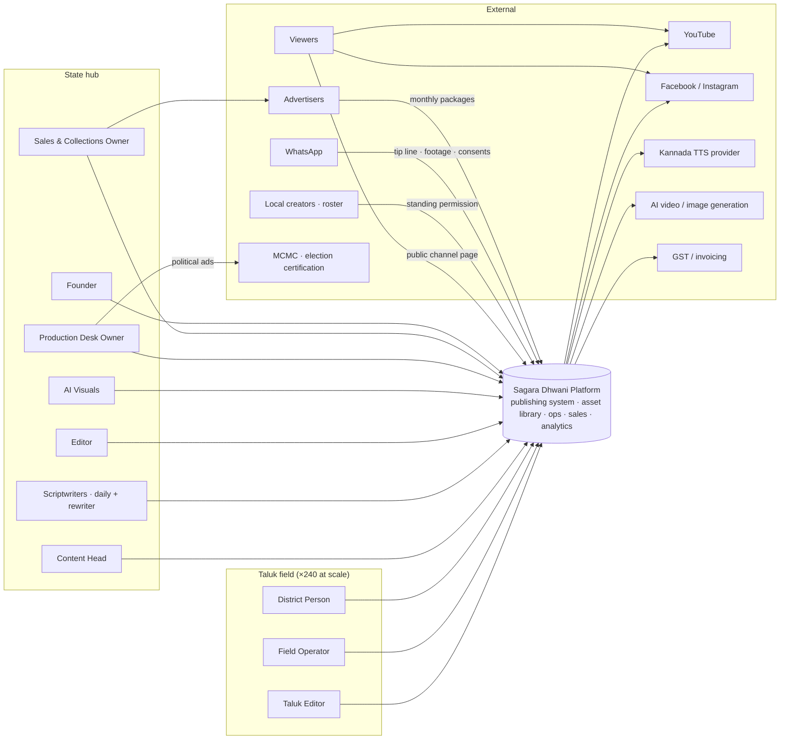
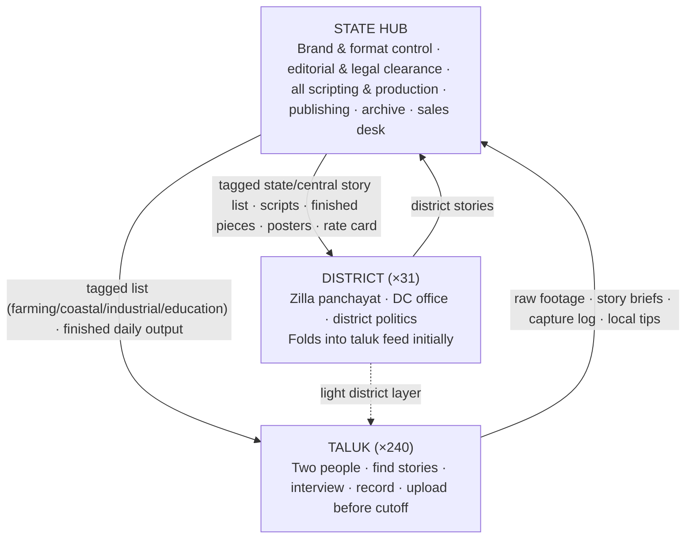
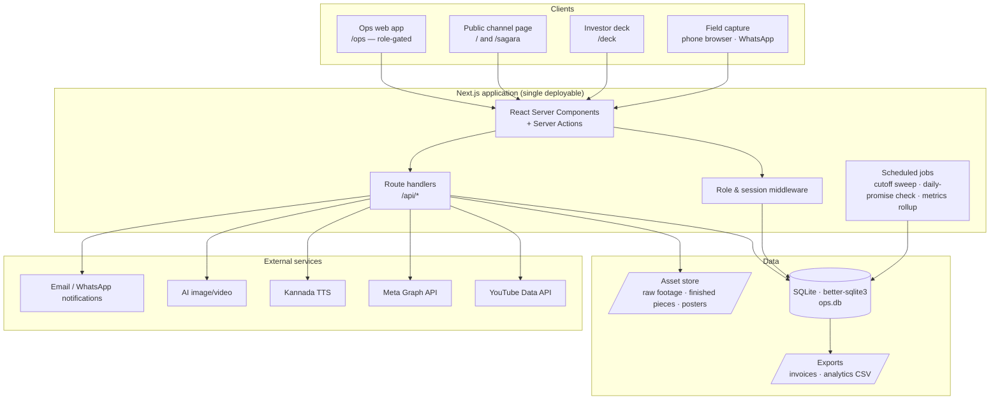
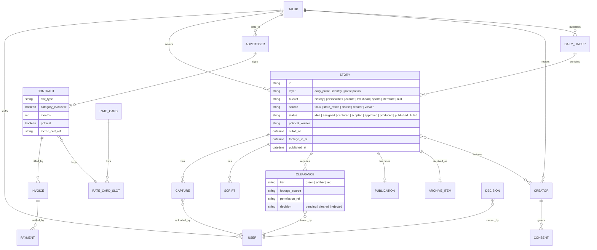
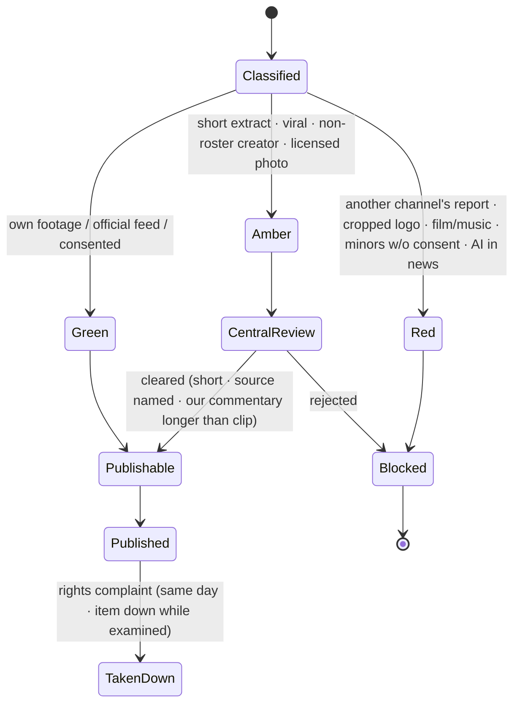
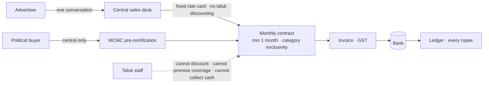

# 01 · Architecture

## 1. Scope

Two kinds of architecture are described, because the plan has two:

- **Organisational architecture** — how content and money flow between state, district and taluk (plan §3).
- **System architecture** — the software that makes the organisational model operable: one publishing system, one asset library, one analytics dashboard (plan §3, "technology backbone").

Everything is centralised by design: taluks capture and send up; the state hub scripts, produces, clears, publishes and archives. The software mirrors that — there is one system, and taluk users have narrow, write-limited roles in it.

## 2. System context (C4 level 1)



## 3. Three-layer organisational flow (plan §3)



**Why production is central** (§3): a taluk person needs only a phone, a mic and local relationships; units are cheap and fast to recruit; one standard across 240 channels; taluk two costs far less than taluk one.

## 4. Container view (C4 level 2)



**Pilot simplification.** For a single taluk the whole system is one Next.js process with an embedded SQLite file and a local asset directory. Platform integrations (YouTube/Meta publishing, TTS, generation) are behind adapter interfaces and are stubbed in the pilot: publishing is scheduled in the system, executed by the state desk, and the platform post URL is recorded back. This keeps the pilot honest about what is proven (daily publishing, advertiser payment) without building integrations before there is an audience.

## 5. Domain model (plan §4–§12)



## 6. Daily pipeline (plan §8.1) — sequence

```mermaid
sequenceDiagram
  autonumber
  participant CH as Content Head
  participant TE as Taluk Editor
  participant FO as Field Operator
  participant SW as Scriptwriters
  participant ED as Editor / AI Visuals
  participant SD as State Desk
  participant SYS as Platform

  CH->>SYS: Morning · publish tagged state/central list (tags: farming, coastal, industrial, education)
  TE->>SYS: Morning · fix 2–3 local stories + 1 identity piece; pick 2–3 state pieces; confirm line-up
  FO->>SYS: Day · captures, interviews, cutaways; capture log entries
  FO->>SYS: Before cutoff · upload files named to standard + story brief
  SYS-->>SD: Cutoff sweep · what arrived, what rolls to tomorrow
  SW->>SYS: Afternoon · write / retell scripts (facts-first workflow §5.2)
  CH->>SYS: Approve every script before voice (named verifier for political)
  ED->>SYS: Evening · edit, graphics, AI voiceover, posters
  SYS-->>SD: Amber clearances pending? block until cleared
  SD->>SYS: Evening · publish on schedule across platforms; record post URLs
  SYS->>SYS: Compute turnaround (footage_in → published) · daily-promise flag
  FO->>SYS: Night · equipment check logged
```

**Turnaround is the key pilot metric** (§8.3): footage-in to published-out, same day = model works; two days = central team is the bottleneck. It is computed per story and rolled up per day.

## 7. Footage clearance state machine (plan §6)



## 8. Money flow (plan §10, §12.2)



## 9. Deployment

| Stage | Topology | Notes |
|-------|----------|-------|
| Pilot (months 0–6) | One VM or PaaS instance · Next.js (Node 22) · SQLite file on persistent disk · assets on disk, nightly copy to object storage | ₹6,000/month hosting line (§14.1). Single taluk; <20 users. |
| Network phase 1 (10–20 taluks) | Same app · Postgres replaces SQLite · object storage for assets · background worker for jobs | Migration path kept open via repository layer. |
| Full scale (240 taluks, ~480 field users) | Horizontal app replicas · managed Postgres · CDN for public pages · queue for publish/render jobs | Analytics rollups move to a warehouse; agency reporting (§10.6) exported from it. |

## 10. Cross-cutting concerns

- **Authority is central.** Publishing, clearance, political verification, political ads, and advertiser screening are state-only operations in the permission matrix (see [10 · Security](10-security-access-control.md)).
- **Everything timestamped.** Cutoff, footage-in, approval, publish — the metric depends on it.
- **Consent is a first-class record.** Creator standing permissions, viewer submission permissions, parental consents are stored and referenced from stories (see [09](09-data-protection-consent.md)).
- **Archive is not optional.** Every identity piece is stored and tagged on publish; the archive is a revenue line (§10.1, §4.5).
- **Honest stubs.** Where an integration is not built, the UI says so and captures the manual step and its evidence (post URL, certificate number, bank reference).

See also: [diagrams/architecture.svg](diagrams/architecture.svg), [diagrams/](diagrams/) for Mermaid sources.
