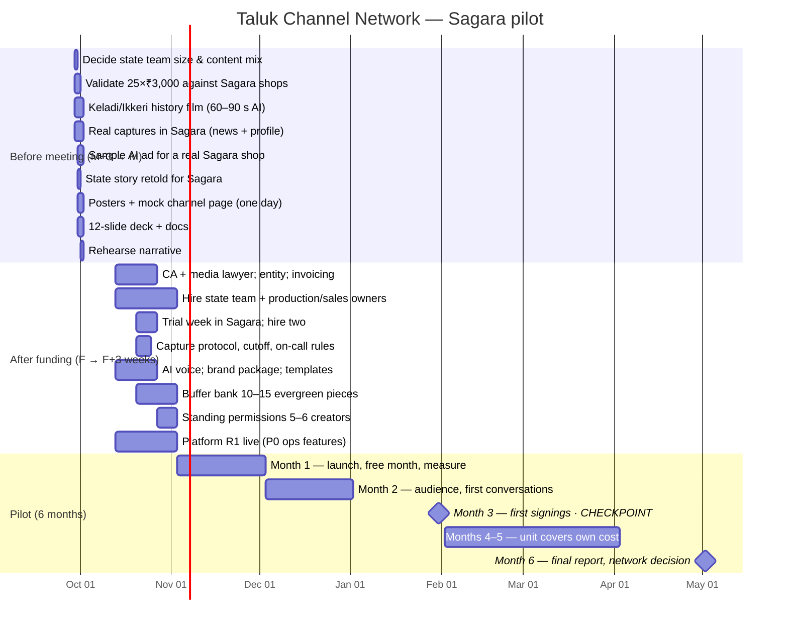

# 12 · Roadmap & Milestones

**Source:** plan §13, §15.4, §18. Dates relative to the investor meeting (M) and funding (F).

## Gates

| Gate | Criteria | Decision |
|---|---|---|
| **G0 — Investor meeting** | One budget figure; validated advertiser assumption; history film; real Sagara pieces; mock channel day; deck | Fund the pilot or not |
| **G1 — Launch readiness (F+3 w)** | Two hires through trial week; protocol and rules written; buffer bank ≥ 10; same-day turnaround demonstrated; rate card structure and invoicing live; creators cleared; AI voice chosen; CA/lawyer engaged | Launch |
| **G2 — Month-3 checkpoint** | Days published / days elapsed; audience per platform; first signings and values; turnaround | Continue; adjust team size |
| **G3 — Month 6** | Unit covers own cost (M4–5 target); rupee values set; playbook from unblock log; network-round decision | Network round; phase-one taluk count and timeline |

## Platform releases

| Release | When | Contents |
|---|---|---|
| R0 — Demo | before M | Public channel page (one full day), deck, docs, seeded ops platform |
| R1 — Pilot core | F+3 w | All P0 features (PRD §5): line-up, captures, cutoff, clearance, creators/consent, scripts/approval, sales/invoicing, archive, dashboard, governance |
| R2 — Pilot ops | months 1–3 | P1 features: week-ahead, equipment/on-call, phonetics, takedown log, political inventory gating, validation worksheet, CSV exports |
| R3 — Network ready | months 4–6 | Agency-format reporting, Postgres migration path, district layer model, notifications adapter |

## Before-meeting action plan (plan §18.1)

| # | Action | Output | Status |
|---|---|---|---|
| 1 | Decide state team size and content mix (17.2) | One budget figure | Open |
| 2 | Validate advertiser assumption against Sagara shops | Confidence in revenue slide | Open |
| 3 | Make the Keladi or Ikkeri history film | 60–90 s AI recreation | Open |
| 4 | Real captures in Sagara | One daily news piece, one personality profile | Open |
| 5 | Sample ad for a real Sagara shop | 30 s AI ad with cost and price | Open |
| 6 | Retell one state story for Sagara | Our script, our AI voice | Open |
| 7 | Posters and mock channel page | Name, logo, 8–10 posts — one full day | **In this repo** |
| 8 | Twelve-slide deck | The deck | **In this repo** |
| 9 | Rehearse the narrative (15.2) | Money case and mission case kept separate | Open |
